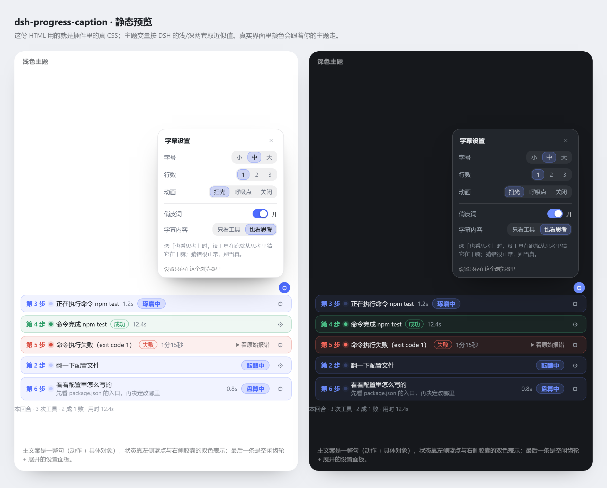

# dsh-progress-caption 思维链进度字幕

在 DSH 的输入框上方加一行小字，回答三个问题：**现在第几步、在干什么、成没成**。
给新手用：不用点开思考过程，也能看懂 AI 卡在哪一步。

```
第 3 步 · 正在执行命令 npm test · 琢磨中
第 2 步 · 正在读取配置文件 · 酝酿中
```

外观是一条圆角胶囊：DeepSeek 蓝的淡底 + 蓝点 + 蓝色步骤号，成功转绿、失败转红。
主文案始终是**一整句**（动作 + 具体命令/文件名），不会再被挤成两个字。
免责声明不再占着这一行——移到鼠标悬停的提示和设置面板里。

## 怎么装

先从 GitHub 克隆到你喜欢的位置（示例放在 `E:\deepseek\插件\plugins\`）：

```bash
git clone https://github.com/wanted09527/dsh-progress-caption.git
```

然后在插件管理器里用它所在的目录安装：
`E:\deepseek\插件\plugins\dsh-progress-caption`
（或在对话里让 agent 调 `plugin_manager` → `install_bundle`，target 填上面的路径）。
本地开发时也可以不克隆，直接用你自己的工作目录。

装完不需要重启：新 bundle 会通过热加载生效；**替换已装包的代码才需要重启**。

## 不做什么

- 不调模型、不发任何外部网络请求、不做翻译。
- 不改 DSH 的任何数据：只读界面已经推过来的快照；设置只存在浏览器本地 `localStorage`。
- 不做历史归档、没有独立的设置页（设置就在字幕条自己的小面板里）、没有侧栏面板（留给第二版）。

## 说人话：三层「它到底在干嘛」

全部靠本机规则和数据推断，不联网、不调模型。按准确度排序，上一层说得出来就不用下一层：

| 层 | 数据来源 | 例子 |
| --- | --- | --- |
| ① 工具事实 | 正在跑/刚跑完的工具 + `argsRaw` | `正在执行命令 npm test`、`正在读 client.js`、`跑完命令 npm test` |
| ② 规则表 | 思考文本末尾 400 字（17 条规则） | `正在理解你的需求`、`正在定位问题`、`正在对比方案`、`正在评估风险` |
| ③ 阶段话术 | 本回合已完成工具的类型序列 | `看完了 3 个文件`、`刚改完 client.js`、`命令跑完了` |
| ④ 空档事实 | 刚跑完的那条工具 + 它花了多久 | `npm test 跑完了 · 1.2s`；这一轮还没跑过工具就交给俏皮词 |
| ⑤ 俏皮词 | 112 个词轮换 | 前面都说不出话时，`酝酿中 / 琢磨中 / 翻箱倒柜 / 摸鱼中` 顶上 |

工具动词分组（不再是「正在执行 读取文件」这种机翻腔）：

| 工具 | 运行中 | 完成 |
| --- | --- | --- |
| bash / pwsh | 正在执行命令 | 跑完命令 |
| read / read_image | 正在读 | 读完了 |
| glob / grep / search_context | 正在搜 | 搜完了 |
| write | 正在写 | 写好了 |
| edit | 正在改 | 改好了 |
| web_search / web_fetch | 正在搜网络资料 | 查完资料 |
| subagent / subagent_fork / send_message | 派了小助手 | 小助手回来了 |
| compress / mnemon_* | 正在翻记忆 | 翻到相关记录 |
| present | 正在整理交付 | 整理好了 |
| todo_write | 正在列计划 | 计划列好了 |
| job_output / job_kill / list_agents | 正在等后台任务 | 后台任务有结果了 |
| ask_user_question | 正在等你回话 | 你回话了 |
| skill | 正在调技能 | 技能调完了 |

对象取自 `argsRaw` 的 `command` / `path`（只留文件名）/ `pattern` / `query`；取不到就只留动词，
绝不猜；太长会截断成 `…`，不会把字幕条撑爆。

> 分组是按真实会话里 6783 次工具调用的 `name` 分布补的：`ops_bash` 1580 次、`pwsh` 1465、
> `read` 845、`edit` 696 之外，`read_image` 330、`mnemon_*` 392、`compress` 92、`present` 50
> 这些以前全掉进 `other`，只能显示「正在执行 read_image」这种把工具名糊上去的句子。

## 节奏：为什么字幕不逐字跟着思维链

v4.1-flash 这类模型思考极快，字是一串串来的。如果字幕逐字跟，会出现一秒跳三次的闪烁。这里的策略是：

| 机制 | 值 | 作用 |
| --- | --- | --- |
| 常驻不闪没 | — | 思考中/跑工具/写回答，字幕一直在；整轮结束才收成齿轮。两步之间 `partial` 会短暂为空，这时说「刚才那件事 + 花了多久」（如 `npm test 跑完了 · 1.2s`），最长容忍 20 秒空档（`TURN_GAP_MS`），不会因此收起来；这一轮还没跑过工具就只显示俏皮词，不写「正在准备下一步」这类空话。步号整轮常驻：`partial` 空档时沿用上一个非空步号，跨轮才清空 |
| 事实优先 | — | 有工具在跑就用工具信息（准确），思考文本只作兜底 |
| 标签稳定窗口 | 520ms，快思考时 800ms | 候选文案要稳住这么久才真正换上去。前 3 步（`SETTLE_STEPS`）连淡入都不播，纯硬切换——那几步状态翻得最勤，淡入叠起来就是「闪」 |
| 最短停留 | 2600ms | 状态结束（开始写回答/工具结束）后，最后一条至少再挂 2.6 秒，想得再快也来得及读完 |
| 快思考判定 | 每秒新增 40 字 | 超过就把切换压到 800ms 一次，字再快也不会闪 |
| 计时刷新 | 无 | 条上那个每秒跳的耗时已整条移除，组件不再为它每秒重渲染（只剩俏皮词每 2.8 秒换一次） |

## 同一个动作，换着说法说

字幕最容易犯的毛病是单调：每次读文件都说「正在读取配置文件」，看十次就麻木了。这里做了两层：

1. **规则库带变体**：17 条规则每条配 3 种说法，按「第几回合 + 第几步」确定性轮换
   （`翻一下配置文件` / `看看配置里怎么写的` / `对一下配置项`）。不随机跳，同一个动作在同一回合里不会来回变。
2. **副行挑一句有信息量的思考**：把「思考原话」开关打开，主文案下面多一行模型自己的思考。
   不是照抄第一句，而是从这段思考里**挑**一句——优先带判断/权衡/卡点的（「因为…」「问题是…」
   「卡在…」「风险是…」），其次带具体东西的（路径、文件名、数字、命令）。
   第一句几乎总是「Now let me…／让我先看看」这种过场话，所以会被跳过，句首的口语垫词也会被剥掉。
   全程只截断、不改写、不润色，所以不会猜错；一段里实在挑不出一句像样的话，这行就不显示。

```
第 6 步  看看配置里怎么写的
         真正的问题是这条字幕没有固定宽度，每次换词都会把左边的字挤走        ◠  [盘算中]
```

关着就只有主文案，界面更紧凑。
（早期版本这里叫「行数 1 / 2 / 3」，但主文案是拼好的整句，几乎不折行，开到 2、3 看不出区别，
那三项实际只起到「要不要显示副行」这一个开关的作用，所以后来换成了这条说人话的开关。）

思考期间**俏皮词一直轮换**（每 2.8 秒换一个）：有事实文案时它挂在最右端当陪衬，
前两层都说不出话时它才顶上当主文案——就是 Claude Code 等待时闪 `Brewing / Pondering / Noodling` 的那种效果。
模型开始写回答时显示「正在组织回答」，一样常驻不消失。

> 觉得还是太快/太慢就改 `client.js` 顶部的 `MIN_SHOW_MS`（默认 2600）和 `OK_LINGER_MS`（成功后停留，默认 5000）。

## 回合小结

每个回合结束时，在对话流末尾那条汇总行前面加一行：

```
本回合 · 3 次工具 · 2 成 1 败 · 用时 12.4s
```

只数事实（工具结果条数、成败、耗时，用 `seq` 卡住回合边界），没有工具调用就完全不显示。
这样滚动回看历史时，能一眼看出那一回合干了多少活。

## 小动画与俏皮词

三种动画，随时可关（设置面板里选）：

| 选项 | 表现 |
| --- | --- |
| 安静（默认） | 左侧三颗小圆点依次轻轻呼吸——只有光晕大小在变，透明度与位移都不动，所以不会「闪」 |
| 扫光 | 三颗点排着队起跳 + 一道光从**左往右**横扫**整条字幕**（不局限于第一行，整框一起扫），光带宽 = 整框宽，只动 `transform`，不推挤布局 |
| 全静止 | 什么都不动，只留一颗点当句号 |

为什么默认是「安静」：思考时文字本来就在飞快地长，字幕条再跟着流光、再跟着跳，两个动的东西
叠在一起就是「一直在闪」。默认档只让三颗 4px 的点做极缓慢的光晕呼吸，主文案是静止的。
成功 / 失败时点会停住并换成绿 / 红。

三颗点仿的是 Claude 主题插件 `dsh-claude-style` 的 await loader（见
`node_modules/dsh-claude-style/lib/client.js` 的 `.dsh-claude-chat-wait-dot`）：容器
`.pgc-loader` 总宽写死 16px，三颗点在 `nth-child` 上用负延迟（`-.6s` / `-.3s`）错开相位，
`@keyframes pgc-hop` 只改 `transform: translateY(...) scaleY(...)`——起点先压扁一点（squash）
再弹起，这就是它看起来「软」而不是机械上下跳的原因。总宽固定，所以跳起来也不会推动右侧文案。

**耗时的位置换成了一个旋转弧线**：原来字幕条右侧那个每秒跳一次的耗时数字已经撤掉（思维链区域
本来就有时间，重复了），位置留给 `.pgc-slot`——宽高写死 `3.6em × 1em`，和原来的耗时格一样宽，
所以俏皮词的位置一点没动。里面是一个只画了一段弧的细圆环（`.pgc-arc`）：匀速绕自己圆心转，
`.9s` 一轮，安静档放慢到 1.5s，成功 / 失败时停住并换成状态色，全静止档完全不动。
为什么不是三个点：条上左侧已经有一组状态点（`.pgc-loader`），右侧再来一组点，同一行两组点
跳相同的舞，看着吵；换成一个弧线，左边说「这一步是什么状态」，右边说「还在转」，形态分得开。
**它也是「思考全程不闪」的一部分**：宽高、周期、幅度都是定死常量，不随内容变化。

**宽度与不闪的三条硬规矩**（`client.js` 的 CSS 段）：

- 宽度跟输入框卡片对齐，但**不是**写 `width:100%`。官方输入卡是两层：父容器
  `.uV2eYG_root` 先左右各留 `--dsh-composer-side-clearance`，再由卡片用
  `max-width: var(--dsh-composer-card-max-width)` 卡上限；而字幕条所在的
  `.wSkVaW_composerStack` **没有内边距**，所以它必须自己减掉两侧留白：
  `width: calc(100% - 2 * var(--dsh-composer-side-clearance, 16px))` +
  `max-width: var(--dsh-composer-card-max-width, 952px)` + `margin: 0 auto`。
  全屏时与输入框等宽居中，不会把整个容器撑满。
- 动画只碰 `opacity / transform / background-position / box-shadow`，绝不改宽高，不会引起重排。
- 俏皮词那一格宽度写死（`width: 6.6em`）。词最短 3 字最长 5 字，如果不写死，每 2.8 秒换词时
  右边一伸缩，左边的状态文字就被推来推去——这也是「闪」的一个来源。
- 系统开「减少动态效果」时，`@media (prefers-reduced-motion: reduce)` 里把动画和过渡全部关掉。
- `.pgc-band` **必须裁剪**（`overflow: hidden`），否则收起途中内容会从 0 高度的框里溢出去，
  压到上面那条排队消息上（就是「指令堆叠时显示异常」）。但裁剪框贴着内容高度时，换词那 2px 的
  `translateY` 又会把俏皮词胶囊的底边切掉一条（只有一行时看得见）。所以给自己加
  `padding-block: 6px; margin-block: -6px`——把裁剪框上下各撑开 6px，再用负外边距抵回去，
  外层占位高度一分不差，位移就切不到了。收起时这两项一起归零，收得干净。
- **扫光要挂在整条胶囊上，不能挂在 `.pgc-band` 上**。`.pgc-band` 只是「文字那一格」，
  右侧放齿轮的 `.pgc-settings` 是它的兄弟节点、不在它里面；光挂在 band 上，扫到 band 右边界
  就断了，右边齿轮那一格永远是暗的，看着就是「光效没占满」。所以根节点里加了一个纯装饰的
  `<span class="pgc-sweep">`，`position: absolute; inset: 0; border-radius: inherit;
  overflow: hidden; pointer-events: none`——光的边界就是整条胶囊的圆角轮廓（齿轮那一格也扫得到），
  又不挡点击。`.pgc-strip` 因此必须有 `position: relative` 当它的定位参照。
  光带本身 `width: 100%` + `translateX(-100%) → translateX(100%)`，是「从左边外面整道扫到右边外面」。

**出现与收起怎么过渡**：

- 整条永远是同一个 DOM，不会在「完整条 / 小齿轮」两套结构间切换（切换会让 React 卸载重建，
  看起来就是闪一下）。收放交给 `.pgc-band` 的 `max-height 7em → 0` + `opacity 1 → 0`
  （`.18s cubic-bezier(.23,1,.32,1)` / `.16s ease`）。
- 收起时内容不会被立刻抽走，而是记住最后画出来的那一帧（`paintedRef`）让它跟着淡出，
  所以「字消失」和「条收缩」是同一个动作，不是先后两段。
- **入场动画只挂在内容层 `.pgc-live` 上**（`pgc-enter`，`.22s`，`opacity 0→1` + `translateY(2px)` + `scale(.984)`），
  一次出现只播一次；根节点故意不挂 `animation`——那会被任何一次重渲染重播，就是你看到的「闪」。
- **换文案、换俏皮词**用 `pgc-swap`（`.16s` / `.2s`）：起点是 `opacity: .45` 而不是 `0`。
  从 0 开始的话，每隔几百毫秒就有一次「字消失再浮现」，观感就是断；从 .45 起跳才是「换了一句话」。
- 缓动曲线用 Emil Kowalski 在
  [`animate` skill](https://github.com/emilkowalski/skills/blob/main/skills/animate/SKILL.md) 里推荐的强 ease-out
  `cubic-bezier(.23,1,.32,1)`（原文还专门提醒：别因为 `cubic-bezier(.4,0,.2,1)` 眼熟就一直用它，
  它是所有「AI 味」界面的默认值）。UI 动画时长一律 ≤300ms，本插件落在 160–260ms。
- 状态点默认做「呼吸」（`pgc-breathe`，2.6s，只改 `box-shadow` 扩散半径，透明度不动）；
  扫光档才换成三点排队起跳（`pgc-hop`，`.9s`，只改 `transform`）；
  颜色从「进行中」翻到「成功 / 失败」是 `.26s` 渐变过去的，不是啪一下换色。
- 三点 loader 的错相位写法参考 `dsh-claude-style` 的 `.dsh-claude-chat-wait-dot`
  （`node_modules/dsh-claude-style/lib/client.js`）：负 `animation-delay` + `transform-origin: 50% 100%`
  + 起跳前 `scale(1.7, .25)` 压扁再弹，视觉上比匀速上下移动更像有重量的东西。
- 官方「思考中」的文字流光由 `@deepseek-ai/dsh-client-ui-primitives` 的 `TextShimmer` 组件实现，
  那是文字级 shimmer、依赖该包内部的渐变遮罩，本插件没复用（该包未解包，无法逐行核对）——**待验证**。
- 参考来源（除上面那条）：官方入场 `.12s ease-out` 与 `.14s cubic-bezier(.2,.8,.2,1)` 见
  `pkgs/dsh-client-ui-chat/package/lib/client.js:192`、统一过渡 `.16s cubic-bezier(.4,0,.2,1)` 见同文件 `:2679`；
  「快速重复触发的元素用 transition 而不是 keyframes」这条原则同样出自上面那份 `animate` skill。


俏皮词（Claude Code 那种 `Brewing / Pondering / Noodling / Vibing` 的味道，中文是「酝酿中 / 琢磨中 / 翻箱倒柜 / 摸鱼中」等 **112 个**）：

- 出现时机：**只要字幕条在，它就在**——思考时、跑工具时、跑完之后都在，位置固定最右端。
  工具事实和规则表都说不出话时，词本身就是主文案。
- 节奏：每 2.8 秒换一个，按顺序轮换，不随机闪回。
- 有俏皮词时自动收起「进行中」标签（进行中改由左侧小圆点的颜色表达），两者不并排；
  只有「成功 / 失败」这种结论性标签会跟它并排。
- 起点按回合错开（`(turn*37 + step) % 词数`），所以每个回合从不同的词开始，末尾的彩蛋不会永远轮不到。
- 开关：设置里可以完全关掉；系统开「减少动态效果」时动画也会自动停。
- 选词标准：**中文单独拎出来也顺口**才算过。直译生硬的（Gusting→鼓风、Harmonizing→和鸣、
  Nucleating→成核、Ionizing→电离、Reticulating→网状化）一律不进表；中文没感觉就宁可不收。
- 彩蛋区（第 98 项往后）：**大鲸鱼**（跃出海面 / 喷水柱 / 潜入深海 / 声呐扫一圈 / 哼鲸歌 /
  求索中 / 深度求索 / 捞磷虾 / 贴着海面掠）、**Δ 增量**（算个增量 / 求积分 / 求个近似）。
  词表在 `client.js` 的 `WORDS_EN` / `WORDS_ZH`，两个数组必须等长、同一行对应同一个词；
  加完跑 `node tools/check-words.mjs` 自检对齐。

## 字幕设置

点字幕条右侧的 `⚙`，从齿轮上方弹出一张毛玻璃浮层（16px 圆角、主题色描边、展开有 180ms 的
淡入＋轻微上浮；系统开「减少动态效果」时自动不动）。里面用**分段选择器 + 滑动开关**，
不再用系统原生的 `<select>`（那玩意就是 WinXP 观感的来源）。

| 设置 | 取值 |
| --- | --- |
| 字号 | 小 11px / 中 12px / 大 13.5px |
| 动画 | 安静（默认）/ 扫光 / 全静止 |
| 字幕条颜色 | 跟随主题 / 海蓝 / 森林 / 日落 / 紫罗兰 / 玫红 / 石墨 |
| 跑成功时 | 跟随主题 / 翠绿 / 青色 |
| 跑失败时 | 跟随主题 / 朱红 / 暖橙 |
| 俏皮词样子 | 淡色底 / 实心 / 素色 |
| 显示俏皮词 | 开 / 关 |
| 思考原话 | 开 / 关（开：主文案下面多一行从模型思考里挑出的一句，不是照抄第一句） |
| 没线索时 | 猜一猜（默认，从思考里猜一句）/ 只报动作（只报工具动作） |

配色分两层。**默认跟随 DSH 主题**，取主题服务暴露的变量，明暗两套自动切换：

| 变量 | 用在哪 |
| --- | --- |
| `--dsw-alias-bg-overlay` | 浮层底色 |
| `--dsw-alias-border-l1` | 浮层描边、分隔线 |
| `--dsw-alias-brand-primary` | 齿轮展开态、分段选中、开关打开 |
| `--dsw-alias-label-primary` / `-secondary` | 标题 / 次要文字 |
| `--dsw-alias-state-success-primary` / `-error-primary` | 成功 / 失败的状态点与徽标 |

有皮肤关掉主题色时（整片灰），可以在设置里手动指定**字幕条颜色 / 成功色 / 失败色**——
选中的颜色会写到字幕条根节点的 `--pgc-accent` / `--pgc-ok` / `--pgc-bad` 上，CSS 优先用它，
没选就用主题变量。（变量和自定义色都不存在时退回 `currentColor` 混色，不会变成透明或黑块。）

**「没线索时」** 是一个二选一，不是开关：

- **猜一猜**（默认）：没有工具在跑时，从思考文本里猜它在干嘛，字幕尽量不断；
- **只报动作**：完全不读思考内容，只有真的调用工具时才出现
  （`正在执行命令 npm test`、`正在读 client.js`……），思考阶段整条收成齿轮，一个字都不猜。

猜出来的内容偶尔会是错的——字幕本来就是装饰，不当证据用。

**俏皮词是常驻的**：只要字幕条在，它就在最右端，并且「进行中」会自动让位（进行中改由左侧
小圆点的颜色表达），所以它永远不会再把主文案挤成两三个字。只有「成功 / 失败」这种结论性
标签会跟它并排。

**没任务在跑的时候**，字幕条会收成右边一个很小的 `⚙`（只占一行的一点点），点它照样能改设置——
不用为了调字号先让模型跑起来。成功态停留 5 秒后也会这样收起来；失败态留着不自动收，方便你看原因。
> 为什么不做在 DSH 的插件设置页：客户端半边能用的服务只有 layout / locale / sessions /
> slots / theme / timer / uiWorkspace / workspaces（我查过实时服务目录），**没有读插件配置的通道**，
> 要接得让宿主半边起一个本机回环接口做桥。v0.1 先用本地存储，够用且零依赖。

## 状态怎么来的

数据只来自 DSH 已推送的快照（`partial` 流式消息、`runningCalls` 正在跑的工具、`nodes` 已结算结果）：

| 状态 | 判定 |
| --- | --- |
| 进行中 | 有工具调用在跑 → 显示工具的人话名字（耗时已撤到只由思维链区域显示，条上不再重复） |
| 思考中 | 最后一块是思考文本 → 按规则表猜（如「正在读取配置文件」） |
| 成功 | 最后一条工具结果结算成功 |
| 失败 | `isError` 为真，或命令结果尾巴是非 0 的 `[exit code: N]` |
| 这一轮没跑完 | 读到宿主的 `turn-error` 节点 → 按 `code` 分三种说法：上游报错 / 你按了停（`INTERRUPTED`）/ 输出到上限（`turn-max-tokens`） |
| 上游在重试 | 读到 `model-retry` 且状态是 `scheduled` → 「等第 N 次重试」，不当成「正在思考」 |

模型已经在写回答时显示「正在组织回答」；整轮结束停留几秒后才收成齿轮，中途不会闪没。

**优先级**：手头真有工具在跑就报工具（那是正在发生的事实），空下来才报回合结局；
重试中排在规则表猜文案之前，因为「正在退避等第 2 次」是事实，「正在读配置」是猜的。

**注意**：bash 命令失败时 DSH 的 `isError` 仍是 `false`（退出码被当作正常数据），
所以失败判定额外解析结果末尾的 `[exit code: N]`，这一点已写进离线测试。
另外，真实会话里「回合级失败」并不少见（抽 637 个回合统计：`completed` 493、`error` 64、
`aborted` 50、`max-tokens` 23、`interrupted` 7），这也是上面两行存在的原因——
以前这些情况字幕只会停在「正在思考」，或者干脆收成齿轮。

## 加一条规则

只改 `client.js` 里 `RULES` 一处（`hit` 里的正则全部命中才算命中，文案自动并进字典）：

```js
{ id: 'write-report', hit: [/报告|\breport\b/i, /写|生成|\bwrite\b/i],
  w: 1.0,
  zh: '正在写报告', en: 'writing a report' },
```

三条约定（都是拿 2000 条真实思考样本量出来的，不是拍脑袋）：

1. **英文词必须套 `\b`**。裸的 `run|step|type|api|build` 会命中 `runtime` / `typeset` 这类词，
   实测曾有 56.9% 的样本至少命中一个裸泛词。
2. **别用大词凑命中率**。`run / build / step / type / api` 已经全部从表中删掉了：
   它们在任何技术文本里都太常见，却不携带「这一刻在干什么」的信息。
   宁可没命中（退回阶段话术或俏皮词），也好过随口猜错。
3. **`w` 是权重**。同时命中多条规则时按 `w` 排序取最高，而不是按数组书写顺序——
   以前是取第一条，实测 2000 条里有 53.2% 会同时命中多条，文案等于由「数组怎么排」决定。
   `w > 1.05` 给「说了就基本确定」的强信号（定位问题、对比方案、评估风险），
   `w ≈ 0.9` 给泛化动作（搜代码、跑命令）。

## 文件

| 文件 | 作用 |
| --- | --- |
| `client.js` | 全部界面逻辑：规则表、字典、状态推导、字幕组件、注册 |
| `index.js` | 宿主半边，空实现（这个插件不需要服务端能力） |
| `cordis.patch.yml` | 往 profile 里插入一行 `dsh-progress-caption` |
| `locale/*.json` | 插件列表里显示的名字和说明 |
| `test/` | 离线测试：假 ctx / 假 store 驱动组件，不起 DSH |

## 开发与打包

```bash
node test/render.test.mjs && node test/package.test.mjs   # 离线测试，全绿才算过
node tools/preview.mjs                                    # 生成 preview.html，双击就能看效果
npm pack --pack-destination dist --cache .npm-cache       # 产出 dist/*.tgz
```

> 别用 `node --test test/`：它要为每个测试文件起子进程，本机沙箱会拒绝（`spawn EPERM`）。
> 直接 `node` 跑每个文件是同一个测试运行器，只是不起子进程。

**改完代码没生效？先确认跑的是不是新代码**：双击 `tools/check-loaded.cmd`。
它比较「DSH 进程启动时间」和「`client.js` 最后修改时间」：

- 绿字 / 退出码 0：跑的是新代码，问题在别处；
- 红字 / 退出码 1：跑的还是旧代码，重启 DSH（或先按 Ctrl+R 只刷新页面）；
- 黄字 / 退出码 2：DSH 没在运行。

## 截图

静态预览图（浅色 + 深色两套，含展开的设置面板）：



真实会话里的画面等重启 DSH 后再补。

## 与宿主的约定

字幕组件靠宿主通过槽位注入的两个 props 工作，两者缺一，插件会安静地不显示任何东西（不会有报错）：

| prop | 用途 | 缺失时 |
| --- | --- | --- |
| `useChat` | 读取当前会话快照（`legacy.partial` / `runningCalls` / `nodes` / `turnEnds`） | 字幕退化成只有齿轮，不报错 |
| `t` | 取中英文案（来自 `locale: 'dshProgressCaption'`） | 回退到内置中文 |

## 卸载

在插件管理器里移除 `dsh-progress-caption` 这一行即可；浏览器里的设置（`localStorage` 键
`dsh-progress-caption:settings`）不进 profile，卸载后残留也无副作用，想清干净可在开发者工具里删掉这个键。

## 许可证

MIT © 2026 陈雅儒
